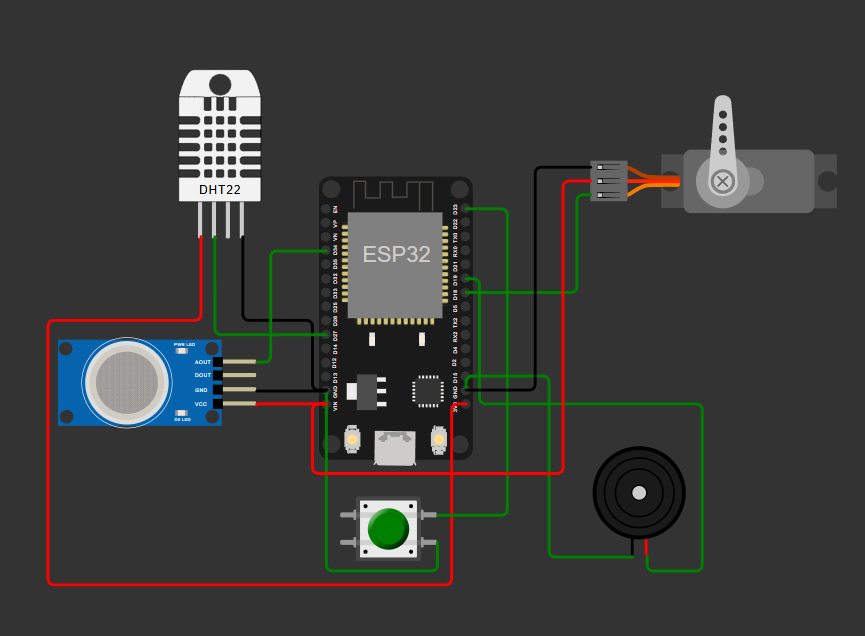
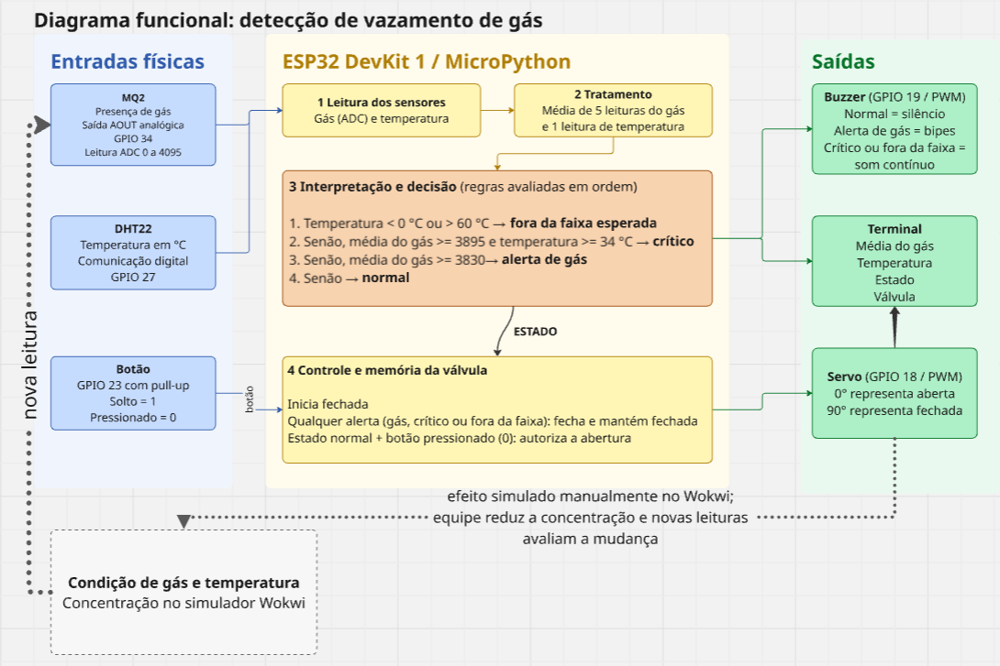

# Smart City | Detecção de vazamento de gás

Protótipo simulado desenvolvido em equipe na disciplina de Fundamentos de
Sistemas Ciberfísicos, no curso de Ciência da Computação da PUCPR.

## Circuito no Wokwi

  

Ver diagrama funcional do protótipo

  

O diagrama registra uma versão anterior da lógica. No [código publicado](./main.py), com temperatura na faixa válida, o alerta crítico ocorre com média do gás ≥ 3895 ou com média ≥ 3830 e temperatura ≥ 34 °C. A válvula pode abrir automaticamente se o primeiro ciclo estiver normal. Após um alerta, a reabertura exige estado normal e o acionamento do botão.

## Como funciona

Um ESP32 programado em MicroPython calcula a média de cinco leituras do
sensor de gás MQ-2 e usa a temperatura medida pelo DHT22 para classificar
o estado do sistema.

Em caso de alerta, um buzzer emite um aviso sonoro e um servomotor simula
o fechamento da válvula. Depois de um alerta, a válvula só reabre
quando as leituras voltam ao normal e o botão é pressionado.

## Arquivos

- `main.py` — leitura dos sensores, lógica de alerta e controle das saídas.
- `diagram.json` — componentes e conexões do circuito no Wokwi.

## Demonstração

- [Abrir a simulação no Wokwi](https://wokwi.com/projects/479527134851950593)
- [Assistir ao vídeo do projeto](https://youtu.be/yNddJqB9T4I)

## Créditos

Projeto desenvolvido em equipe. Fiquei responsável pela
arquitetura do sistema e pela programação em MicroPython.
